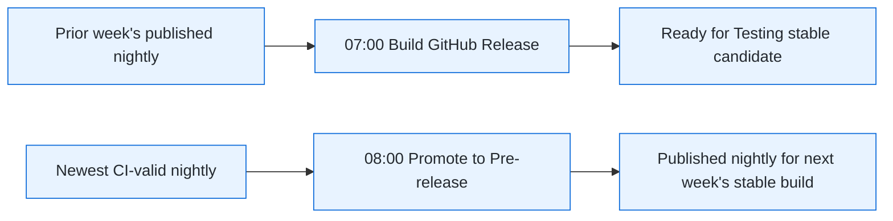

# Release Manager Workflow

Canonical operational policy: [docs/release-testing-guide.md](../../../docs/release-testing-guide.md).
Read it before dispatching, approving, or promoting a release. This skill
inspects and operates the release train; it does not replace the manual QA
decision.

## Release States

Use these terms precisely:

- **Nightly:** daily `vX.Y.Z-nightly.develop.YYYYMMDD` GitHub pre-release.
- **Published marketplace pre-release:** normally a nightly whose title ends
  in ` - published`; the weekly stable build consumes that nightly. Emergency
  hotfix tags require explicit source selection; see the hotfix runbook.
- **Stable candidate:** `Release X.Y.Z - Ready for Testing`; stable-version
  VSIXs awaiting manual QA.
- **Approved stable release:** `Release X.Y.Z - Tested & Approved`; the
  stable candidate passed QA and triggered registry publishing.

`Tested & Approved` never applies to nightly or emergency prerelease-packaged VSIXs.

## Step 0 - Diagnose the Release Train

Run these read-only commands before suggesting a release action:

```sh
gh release list --repo forcedotcom/salesforcedx-vscode --limit 15
gh run list --repo forcedotcom/salesforcedx-vscode --status waiting --limit 20 \
  --json databaseId,workflowName,displayTitle,createdAt,url
gh run list --repo forcedotcom/salesforcedx-vscode --workflow nightly.yml --limit 3 \
  --json databaseId,status,conclusion,createdAt,url
gh run list --repo forcedotcom/salesforcedx-vscode --workflow promote-to-prerelease.yml --limit 3 \
  --json databaseId,status,conclusion,createdAt,url
gh run list --repo forcedotcom/salesforcedx-vscode --workflow build-github-release.yml --limit 3 \
  --json databaseId,status,conclusion,createdAt,url
```

Report a compact table containing the newest nightly, newest `- published`
nightly, newest stable candidate, newest `Tested & Approved` release, pending
registry runs, and any failed prerequisite. This diagnostic step is read-only:
record waiting registry runs for the Wednesday release ceremony, but do not
approve, cancel, or dispatch anything. Verify that the published nightly's
version is greater than any stable release awaiting publication; otherwise
report the version mismatch as a release-train problem. State the next action
and why.

The Wednesday schedule is intentional:



Do not infer that a new 08:00 marketplace pre-release should be input to the
same day's 07:00 stable build.

## Step 1 - Recover Prerequisites When Needed

Weekly nightly recovery only. Existing hotfix tracking tags or an already-built
candidate need [explicit source/version selection](../../../docs/release-testing-guide.md#later-stable-candidate-from-a-patched-prerelease),
not a default rerun. Keep existing tags/assets unchanged.

Use this only when diagnosis shows a broken release train. Before every
dispatch, show the user the failed run, selected source tag, expected output,
and the exact command. Wait for explicit confirmation.

### Nightly Failed

Rerun or repair `nightly.yml` first. Promotion's gate requires the nightly's
package and GitHub-release checks to succeed.

```sh
gh run rerun <nightly-run-id> --repo forcedotcom/salesforcedx-vscode
```

Wait for success before continuing.

### Promotion Gate Failed

After its nightly succeeds, rerun the failed promotion. The successful run
must create the tracking tag and append ` - published` to the selected nightly
release title.

```sh
gh run rerun <promotion-run-id> --repo forcedotcom/salesforcedx-vscode
```

Verify with:

```sh
gh release list --repo forcedotcom/salesforcedx-vscode --limit 10
```

### Stable Build Used Stale Input

If the scheduled stable build ran before promotion recovery, it can resolve an
older tracking tag and fail on an already-existing release tag. Once promotion
is successful, a normal `build-github-release.yml` rerun can consume the new
published nightly.

Before dispatching, report the expected source and target. Example:

```text
Source: v68.5.5-nightly.develop.20261021
Expected stable candidate: v68.6.0
```

After explicit confirmation:

```sh
gh workflow run build-github-release.yml --repo forcedotcom/salesforcedx-vscode
```

Monitor the new run and verify its log says both:

```text
Resolved to nightly tag: vX.Y.Z-nightly.develop.YYYYMMDD
Release version: X.Y.0
```

Do not use `startFromRef` for ordinary recovery. It bypasses the normal nightly
validation path and is for emergency workflows.

## Step 2 - Download the Stable Candidate

Use a stable candidate titled `Ready for Testing` for stable-release QA. Pass
its tag explicitly; tag-less `gh release download` selects GitHub's latest
full release instead of a pre-release.

```sh
gh release download v<version> \
  --dir ~/Downloads/v<version> \
  --pattern '*.vsix' \
  --repo forcedotcom/salesforcedx-vscode
```

Ask whether to use `code` or `code-insiders` (default `code`), then install:

```sh
find ~/Downloads/v<version> -type f -name "*.vsix" -exec <binary> --install-extension {} \;
```

Follow the required cases in the team's [Release Testing Slack canvas](https://salesforce.enterprise.slack.com/docs/T092Z56AE/F0B7RLRUSRG). Create or use the release-specific testing document from that canvas, record the candidate tag being tested, and capture the pass/fail evidence there.

Do not continue until the user explicitly confirms stable-candidate QA passed.

## Step 3 - Mark a Stable Candidate Tested and Approved

After explicit QA confirmation only, promote the stable candidate from GitHub
pre-release to a full release:

```sh
gh release edit v<version> --prerelease=false \
  --title "Release <version> - Tested & Approved" \
  --latest \
  --repo forcedotcom/salesforcedx-vscode
```

The `--prerelease=false` transition emits `release: released` and automatically
creates two registry publication workflows. The title and `--latest` flag are
human-facing metadata; they do not trigger publishing independently.

## Step 4 - Approve and Verify Registry Publication

For normal weekly releases, locate the automatically created runs instead of
dispatching new ones. Stable patches and arbitrary-ref candidates require the
[hotfix publication workaround](../../../docs/release-testing-guide.md#publish-a-stable-hotfix):
release-event runs lack `isHotfix=true` and skip the exact-commit test gate.
Leave those runs unapproved; follow the runbook before dispatching hotfix runs.

```sh
gh run list --workflow=publishVSCode.yml -L 5 \
  --json databaseId,status,url,displayTitle,createdAt \
  --repo forcedotcom/salesforcedx-vscode
gh run list --workflow=publishOpenVSX.yml -L 5 \
  --json databaseId,status,url,displayTitle,createdAt \
  --repo forcedotcom/salesforcedx-vscode
```

Expected result: one `publish` environment-gated run for Microsoft Marketplace
and one for Open VSX. Ask for explicit confirmation before directing the user
to approve either in GitHub Actions.

For normal weekly releases, if duplicate pairs exist, choose one Marketplace
run and one Open VSX run; approve only that pair. After both succeed, cancel
duplicates. A manual
`workflow_dispatch` is retry-only if the release event failed to create a run
or a specific registry workflow failed.

Monitor approved runs:

```sh
gh run watch <databaseId> --repo forcedotcom/salesforcedx-vscode
```

Verify live registry state:

- [Microsoft Marketplace](https://marketplace.visualstudio.com/items?itemName=salesforce.salesforcedx-vscode)
- [Open VSX](https://open-vsx.org/extension/salesforce/salesforcedx-vscode)

## Step 5 - Communicate

Compose the release announcement from the top section of
`packages/salesforcedx-vscode/CHANGELOG.md`:

- Header: `*Salesforce Extensions for VS Code v<version> is out* :tada:`
- Link: `VS Code Marketplace: https://marketplace.visualstudio.com/items?itemName=salesforce.salesforcedx-vscode`
- Include `Added` and `Fixed` entries; omit PR and issue trailers.

Show the draft before posting or drafting it in `#platform-dev-tools`.

## Changelog Correction After a VSIX Exists

Do not edit, retag, or replace an existing VSIX. A correction after a stable
candidate or published release must ship as a new patch release.

Before suggesting a mutating action, report the affected tag, proposed unused
patch version, correction scope, and the exact commands. Wait for explicit
confirmation.

Follow [Changelog-Only Correction After a VSIX Exists](../../../docs/release-testing-guide.md#changelog-only-correction-after-a-vsix-exists).
It uses the affected release tag, an explicit unused patch version, and the
stable hotfix publication gates, not normal weekly release-event runs. Merge
the correction to `develop` separately; exclude release-only version bumps.

## Emergency Hotfixes

For critical production bugs, use **`/patch-release`** and the canonical
[hotfix runbook](../../../docs/release-testing-guide.md#patch-release-workflow).
