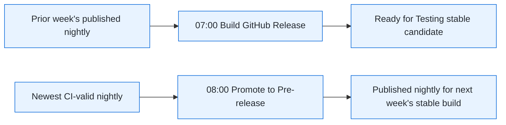

# Release Manager Workflow

Canonical operational policy: [docs/release-testing-guide.md](../../../docs/release-testing-guide.md).
Read it before dispatching, approving, or promoting a release. This skill
inspects and operates the release train; it does not replace the manual QA
decision.

## Releasability Dashboard Maintenance

When a change affects a release-train gate or state transition, evaluate
whether `.github/workflows/release-dashboard.yml` and
`scripts/releaseDashboard.sh` must change in the same PR. Record an intentional
out-of-scope dashboard update in the plan or review.

Dashboard-affecting changes include:

- `nightly.yml`, `promote-to-prerelease.yml`, `build-github-release.yml`,
  `publishVSCode.yml`, or `publishOpenVSX.yml`
- workflow names, schedules, inputs, triggers, job dependencies, gate
  predicates, required check names, or retry behavior
- tag formats, tracking tags, release titles/assets, source provenance, manual
  approval, publish-environment approval, or registry verification behavior
- `develop` feeder build, unit-test, or E2E evidence

When affected, ensure the dashboard still:

1. Resolves the exact artifact and commit consumed by each stage, including the
   one-week pre-release to stable offset.
2. Separates required gates from advisory/post-hoc signals. Do not make E2E a
   hard stop unless the release workflow explicitly requires it.
3. Correlates evidence by tag, commit, and job result instead of selecting an
   unrelated repository-wide latest run.
4. Reports missing or unavailable evidence as such, never as successful.
5. Stays read-only; it must not dispatch, approve, publish, edit releases, or
   mutate branches/tags.

Update dashboard tests for each changed dependency, gate, or state
classification. Run `pnpm test:scripts` and `pnpm check:actions` after
dashboard or release-workflow changes.

## Release States

Use these terms precisely:

- **Nightly:** daily `vX.Y.Z-nightly.develop.YYYYMMDD` GitHub pre-release.
- **Published marketplace pre-release:** a nightly whose title ends in
  ` - published`; it is the input to the following week's stable build.
- **Stable candidate:** `Release X.Y.Z - Ready for Testing`; stable-version
  VSIXs awaiting manual QA.
- **Approved stable release:** `Release X.Y.Z - Tested & Approved`; the
  stable candidate passed QA and triggered registry publishing.

`Tested & Approved` never applies to a nightly pre-release.

## Step 0 - Diagnose the Release Train

Run these read-only commands before suggesting a release action:

```sh
gh release list --repo forcedotcom/salesforcedx-vscode --limit 15
gh run list --repo forcedotcom/salesforcedx-vscode --status waiting --limit 20 \
  --json databaseId,workflowName,displayTitle,createdAt,url
gh run list --repo forcedotcom/salesforcedx-vscode --workflow nightly.yml --limit 3 \
  --json databaseId,status,conclusion,createdAt,url
gh run list --repo forcedotcom/salesforcedx-vscode --workflow promote-to-prerelease.yml --limit 3 \
  --json databaseId,status,conclusion,createdAt,url
gh run list --repo forcedotcom/salesforcedx-vscode --workflow build-github-release.yml --limit 3 \
  --json databaseId,status,conclusion,createdAt,url
```

Report a compact table containing the newest nightly, newest `- published`
nightly, newest stable candidate, newest `Tested & Approved` release, pending
registry runs, and any failed prerequisite. This diagnostic step is read-only:
record waiting registry runs for the Wednesday release ceremony, but do not
approve, cancel, or dispatch anything. Verify that the published nightly's
version is greater than any stable release awaiting publication; otherwise
report the version mismatch as a release-train problem. State the next action
and why.

The Wednesday schedule is intentional:



Do not infer that a new 08:00 marketplace pre-release should be input to the
same day's 07:00 stable build.

## Step 1 - Recover Prerequisites When Needed

Use this only when diagnosis shows a broken release train. Before every
dispatch, show the user the failed run, selected source tag, expected output,
and the exact command. Wait for explicit confirmation.

### Nightly Failed

Rerun or repair `nightly.yml` first. Promotion's gate requires the nightly's
package and GitHub-release checks to succeed.

```sh
gh run rerun <nightly-run-id> --repo forcedotcom/salesforcedx-vscode
```

Wait for success before continuing.

### Promotion Gate Failed

After its nightly succeeds, rerun the failed promotion. The successful run
must create the tracking tag and append ` - published` to the selected nightly
release title.

```sh
gh run rerun <promotion-run-id> --repo forcedotcom/salesforcedx-vscode
```

Verify with:

```sh
gh release list --repo forcedotcom/salesforcedx-vscode --limit 10
```

### Stable Build Used Stale Input

If the scheduled stable build ran before promotion recovery, it can resolve an
older tracking tag and fail on an already-existing release tag. Once promotion
is successful, a normal `build-github-release.yml` rerun can consume the new
published nightly.

Before dispatching, report the expected source and target. Example:

```text
Source: v68.5.5-nightly.develop.20261021
Expected stable candidate: v68.6.0
```

After explicit confirmation:

```sh
gh workflow run build-github-release.yml --repo forcedotcom/salesforcedx-vscode
```

Monitor the new run and verify its log says both:

```text
Resolved to nightly tag: vX.Y.Z-nightly.develop.YYYYMMDD
Release version: X.Y.0
```

Do not use `startFromRef` for ordinary recovery. It bypasses the normal nightly
validation path and is for emergency workflows.

## Step 2 - Download the Stable Candidate

Use a stable candidate titled `Ready for Testing` for stable-release QA. Pass
its tag explicitly; tag-less `gh release download` selects GitHub's latest
full release instead of a pre-release.

```sh
gh release download v<version> \
  --dir ~/Downloads/v<version> \
  --pattern '*.vsix' \
  --repo forcedotcom/salesforcedx-vscode
```

Ask whether to use `code` or `code-insiders` (default `code`), then install:

```sh
find ~/Downloads/v<version> -type f -name "*.vsix" -exec <binary> --install-extension {} \;
```

Follow the required cases in the team's [Release Testing Slack canvas](https://salesforce.enterprise.slack.com/docs/T092Z56AE/F0B7RLRUSRG). Create or use the release-specific testing document from that canvas, record the candidate tag being tested, and capture the pass/fail evidence there.

Do not continue until the user explicitly confirms stable-candidate QA passed.

## Step 3 - Mark a Stable Candidate Tested and Approved

After explicit QA confirmation only, promote the stable candidate from GitHub
pre-release to a full release:

```sh
gh release edit v<version> --prerelease=false \
  --title "Release <version> - Tested & Approved" \
  --latest \
  --repo forcedotcom/salesforcedx-vscode
```

The `--prerelease=false` transition emits `release: released` and automatically
creates two registry publication workflows. The title and `--latest` flag are
human-facing metadata; they do not trigger publishing independently.

## Step 4 - Approve and Verify Registry Publication

Locate the automatically created runs instead of dispatching new ones:

```sh
gh run list --workflow=publishVSCode.yml -L 5 \
  --json databaseId,status,url,displayTitle,createdAt \
  --repo forcedotcom/salesforcedx-vscode
gh run list --workflow=publishOpenVSX.yml -L 5 \
  --json databaseId,status,url,displayTitle,createdAt \
  --repo forcedotcom/salesforcedx-vscode
```

Expected result: one `publish` environment-gated run for Microsoft Marketplace
and one for Open VSX. Ask for explicit confirmation before directing the user
to approve either in GitHub Actions.

If duplicate pairs exist, choose one Marketplace run and one Open VSX run;
approve only that pair. After both succeed, cancel duplicates. A manual
`workflow_dispatch` is retry-only if the release event failed to create a run
or a specific registry workflow failed.

Monitor approved runs:

```sh
gh run watch <databaseId> --repo forcedotcom/salesforcedx-vscode
```

Verify live registry state:

- [Microsoft Marketplace](https://marketplace.visualstudio.com/items?itemName=salesforce.salesforcedx-vscode)
- [Open VSX](https://open-vsx.org/extension/salesforce/salesforcedx-vscode)

## Step 5 - Communicate

Never source the announcement from `develop`'s `CHANGELOG.md`. After
Wednesday promotion its top section is the new pre-release's delta, not the
stable release's.

Start from the changelog shipped in the stable VSIX:

```sh
gh release download v<version> --repo forcedotcom/salesforcedx-vscode \
  --pattern 'salesforcedx-vscode-<version>.vsix' --dir /tmp/v<version>
unzip -p /tmp/v<version>/salesforcedx-vscode-<version>.vsix extension/changelog.md
```

It holds 1 week's section and can be wrong (see
[Stable Changelog Source](#stable-changelog-source)). Verify against git
before drafting. Previous stable = latest **Marketplace** stable version; a
`Tested & Approved` GitHub release may never have published.

1. Each entry's commit must be in `v<version>` and not in the previous stable:
   ```sh
   git log --oneline -1 --grep='(#<pr>)' origin/develop
   git merge-base --is-ancestor <commit> v<version>          # must succeed
   git merge-base --is-ancestor <commit> v<previous-stable>  # must fail
   ```
2. Find omitted entries: read each weekly changelog commit on `develop` since
   the previous stable's source nightly; include entries passing check 1.
   ```sh
   git log --format='%h %ad %s' --date=short --grep='changelog for prerelease' \
     origin/develop -- packages/salesforcedx-vscode/CHANGELOG.md
   git show <commit>:packages/salesforcedx-vscode/CHANGELOG.md
   ```
3. Drop entries already announced by a stable patch (e.g. hotfix in `X.Y.1`).

Format:

- Header: `**Salesforce Extensions for VS Code v<version> is out** :tada:`
- Link: `VS Code Marketplace: https://marketplace.visualstudio.com/items?itemName=salesforce.salesforcedx-vscode`
- Include `Added` and `Fixed` entries, grouped by package; omit PR and issue trailers.
- Bold with `**bold**`; a single `*` renders italic in Slack.

Show the draft before posting or drafting it in `#platform-dev-tools`.

## Stable Changelog Source

No tag contains the changelog that ships. `promote-to-prerelease.yml` commits
each week's delta to `develop` after that nightly is cut.
`build-github-release.yml` copies `develop`'s file into the working tree,
relabels `# <nightly version>` → `# <stable version>`, and packages without
committing.

Failure modes:

- **Late build:** a stable built after a later promotion copies the wrong
  week's section. Relabel finds no matching header, no-ops, and the step
  still logs `✓ Relabeled changelog`; the preceding `No "# X.Y.Z" header
  found` line is the signal. Example: v68.4.0, built from `v68.1.1`, shipped
  the `# 68.3.1` section.
- **`startFromRef`:** relabel is skipped (`not a nightly tag`); the VSIX ships
  the source ref's file, usually last week's section. Before dispatching,
  commit the correct section to the source branch, as in
  [Changelog Correction](#changelog-correction-after-a-vsix-exists) step 2.

After any stable build, check `unzip -p <vsix> extension/changelog.md | head -1`
shows `# <stable version>` with the expected entries.

## Changelog Correction After a VSIX Exists

Do not edit, retag, or replace an existing VSIX. A correction after a stable
candidate or published release must ship as a new patch release.

Before suggesting a mutating action, report the affected tag, proposed unused
patch version, correction scope, and the exact commands. Wait for explicit
confirmation.

1. Create a patch branch from the affected release tag.
2. Commit only the changelog correction.
3. Dispatch `build-github-release.yml` using `startFromRef` for that branch
   and an explicit new `releaseVersion`.
4. QA and publish the new patch candidate through Steps 2 through 4.
5. Cherry-pick the changelog-correction commit to `develop`; never
   cherry-pick the release-only version-bump commit.

Example for correcting a released `v68.6.0`:

```sh
git checkout -b patch/changelog-v68.6.1 v68.6.0
# Edit packages/salesforcedx-vscode/CHANGELOG.md.
git add packages/salesforcedx-vscode/CHANGELOG.md
git commit -m "docs: correct v68.6.0 changelog"
git push -u origin patch/changelog-v68.6.1

gh workflow run build-github-release.yml \
  -f startFromRef="patch/changelog-v68.6.1" \
  -f releaseVersion="68.6.1" \
  --repo forcedotcom/salesforcedx-vscode
```

Use this deliberate `startFromRef` path only for a post-VSIX correction or
other approved patch release. It is not the recovery path for a failed weekly
train, because it bypasses normal nightly validation.

## Emergency Hotfixes

For critical production bugs, use the separate **`/patch-release`** skill.
