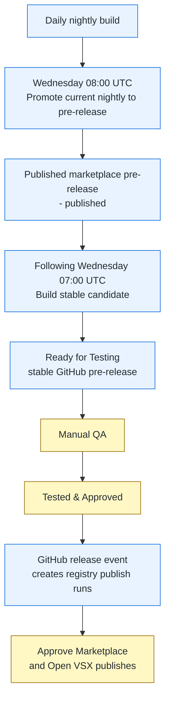
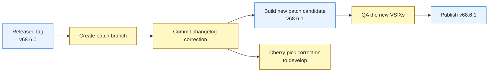
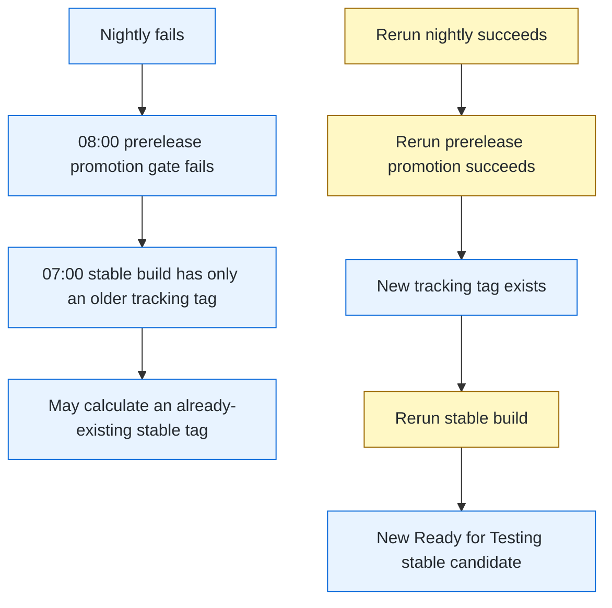

# Release Testing Guide

Operational runbook for the weekly release manager. It covers the normal
release train, manual QA, publication approvals, and recovery when a
prerequisite workflow fails.

## Release States

Four release artifacts have similar names but serve different purposes:

| Artifact | Example | Created by | Meaning |
|---|---|---|---|
| Nightly | `v68.5.5-nightly.develop.20261021` | `nightly.yml` | Daily build from `develop`. Not necessarily selected for the weekly train. |
| Published marketplace pre-release | Nightly title ends in `- published` | `promote-to-prerelease.yml` | Weekly prerelease published to both registries. It becomes the input to the following week's stable build. |
| Stable candidate | `Release 68.6.0 - Ready for Testing` | `build-github-release.yml` | Stable-version VSIX assets awaiting manual QA. |
| Approved stable release | `Release 68.6.0 - Tested & Approved` | Release manager | Stable candidate that passed QA and triggered stable registry publication. |

`Tested & Approved` is only valid for a stable candidate. Do not apply it to
a nightly or marketplace pre-release.

## Weekly Release Train



Blue steps are automated CI/CD. Yellow steps require release-manager action.

The scheduled workflow order is intentional:

1. At **07:00 UTC**, `build-github-release.yml` consumes the prior week's
   published marketplace pre-release. It creates the stable tag and assets,
   including the isolated `release-staging/vX.Y.0` build workspace and a
   `Ready for Testing` GitHub pre-release.
2. At **08:00 UTC**, `promote-to-prerelease.yml` promotes the newest
   CI-valid nightly. It creates the `marketplace-prerelease-*` tracking tag,
   publishes prerelease artifacts to both registries, and appends
   ` - published` to the nightly title.

The 08:00 pre-release is deliberately not consumed by the 07:00 build on the
same day. It receives a week of marketplace validation before becoming input
to a stable candidate.

### Happy-Path Example

```text
Week N, Wednesday 08:00
  v68.5.5-nightly.develop.20261021
  -> promoted to Marketplace and Open VSX as prerelease
  -> GitHub release title becomes
     "salesforcedx-vscode v68.5.5 (Nightly develop 20261021) - published"

Week N+1, Wednesday 07:00
  build-github-release.yml consumes v68.5.5-nightly.develop.20261021
  -> creates release-staging/v68.6.0 in its build workspace
  -> creates GitHub pre-release v68.6.0 titled
     "Release 68.6.0 - Ready for Testing"

After stable-candidate QA passes
  v68.6.0 title becomes "Release 68.6.0 - Tested & Approved"
  -> GitHub marks it as a full release and Latest
  -> creates one waiting publish workflow for Microsoft Marketplace
  -> creates one waiting publish workflow for Open VSX
```

Check those visible release-record clues with:

```bash
gh release list --repo forcedotcom/salesforcedx-vscode --limit 10
```

Expected rows for this example:

```text
TITLE                                                               TYPE         TAG NAME                          PUBLISHED
Release 68.6.0 - Ready for Testing                                  Pre-release  v68.6.0                           about 1 hour ago
salesforcedx-vscode v68.5.5 (Nightly develop 20261021) - published  Pre-release  v68.5.5-nightly.develop.20261021  about 3 hours ago
salesforcedx-vscode v68.5.4 (Nightly develop 20261020)              Pre-release  v68.5.4-nightly.develop.20261020  about 1 day ago
playwright-vscode-ext-v1.7.2                                                     playwright-vscode-ext-v1.7.2      about 4 days ago
Release 68.4.0 - Tested & Approved                                  Latest       v68.4.0                           about 4 days ago
salesforcedx-vscode v68.3.3 (Nightly develop 20261016)              Pre-release  v68.3.3-nightly.develop.20261016  about 5 days ago
```

The `Ready for Testing` and `Tested & Approved` rows are successive states of
the same stable tag; they do not exist simultaneously. The `- published`
nightly remains a pre-release and is the next stable build's input.

## Monday Checklist

At the start of the release-manager work week, inspect the train without
approving, cancelling, or dispatching anything:

1. Open the latest [Releasability Dashboard workflow run](https://github.com/forcedotcom/salesforcedx-vscode/actions/workflows/release-dashboard.yml).
   Its job summary presents the nightly, prerelease-promotion, stable-build,
   and per-registry publication states together with the current artifacts,
   derived blocker, and a read-only recovery recommendation. It refreshes after
   the scheduled nightly and Wednesday promotion; use **Run workflow** for a
   current snapshot during an incident.
   The dashboard's `develop` test-health section is intentionally strict about
   evidence: a failed current-commit build or unit check is a hard no, while a
   missing check is `not verified`, not a pass. The current unit/build workflows
   run on merged PR heads rather than direct `develop` pushes, so use this
   section as feeder evidence rather than asserting direct branch coverage.
2. Use the commands below when the dashboard links to a failed or ambiguous
   workflow and its logs need closer inspection.

```bash
gh release list --repo forcedotcom/salesforcedx-vscode --limit 15
gh run list --repo forcedotcom/salesforcedx-vscode --status waiting --limit 20 \
  --json databaseId,workflowName,displayTitle,createdAt,url
gh run list --repo forcedotcom/salesforcedx-vscode --workflow build-github-release.yml --limit 3
gh run list --repo forcedotcom/salesforcedx-vscode --workflow promote-to-prerelease.yml --limit 3
```

Expected signals:

- A prior stable release titled `Tested & Approved` may have exactly two
  waiting runs: one `Publish Release to Marketplace` and one `Publish in Open
  VSX Registry`. Their presence confirms that stable publication is ready for
  the Wednesday release ceremony; do not approve them during the Monday check.
- A successful promoted nightly has a title ending in `- published` and is a
  pre-release.
- The promoted nightly version must be greater than the stable release awaiting
  publication. For example, a published `v68.5.5-nightly.develop.20261021`
  is ahead of pending stable `v68.4.0`. If it is not ahead, stop and diagnose
  the release-train state before Wednesday.
- A successful stable build has a GitHub pre-release titled
  `Release X.Y.Z - Ready for Testing`.

If duplicate publish runs exist, record their URLs and defer handling them to
the Wednesday release ceremony. At that time, approve one Marketplace run and
one Open VSX run; after the selected pair succeeds, cancel the duplicate pair.

## Testing Checklist

### 1. Select the Correct QA Artifact

`gh release download` without a tag downloads GitHub's latest full release.
It does not select a prerelease candidate.

```bash
gh release list --repo forcedotcom/salesforcedx-vscode --limit 10
```

Example output:

```text
TITLE                                                               TYPE         TAG NAME                          PUBLISHED
Release 68.6.0 - Ready for Testing                                  Pre-release  v68.6.0                           about 1 hour ago
salesforcedx-vscode v68.5.5 (Nightly develop 20261021) - published  Pre-release  v68.5.5-nightly.develop.20261021  about 3 hours ago
salesforcedx-vscode v68.5.4 (Nightly develop 20261020)              Pre-release  v68.5.4-nightly.develop.20261020  about 1 day ago
playwright-vscode-ext-v1.7.2                                                     playwright-vscode-ext-v1.7.2      about 4 days ago
Release 68.4.0 - Tested & Approved                                  Latest       v68.4.0                           about 4 days ago
salesforcedx-vscode v68.3.3 (Nightly develop 20261016)              Pre-release  v68.3.3-nightly.develop.20261016  about 5 days ago
```

Choose the tag that matches the QA stage:

- **Marketplace prerelease validation:** newest nightly row ending in
  `- published`.
- **Stable-candidate QA:** `Ready for Testing` stable tag, such as `v68.6.0`.

Download the selected tag explicitly:

```bash
# Example: QA a stable candidate
gh release download v68.6.0 --dir ~/Downloads/latestVSCode --pattern '*.vsix' --repo forcedotcom/salesforcedx-vscode
```

### 2. Install Extensions Locally

```bash
cd ~/Downloads/latestVSCode
find . -name "*.vsix" -exec code --install-extension {} \;
```

### 3. Run Manual QA Tests

Follow the required test cases in the team's [Release Testing Slack canvas](https://salesforce.enterprise.slack.com/docs/T092Z56AE/F0B7RLRUSRG). Create or use the release-specific testing document from that canvas, record the candidate tag being tested, and capture the pass/fail evidence there.

### 4. Record the Decision

**Stable candidate passes:** Record testing evidence, then follow
[Stable Release](#stable-release) to mark that stable tag `Tested & Approved`.

**Marketplace pre-release passes:** Record the evidence. It remains a
pre-release and is consumed by the following week's stable build.

**Tests fail:** Do not mark the stable candidate `Tested & Approved` and do
not approve its registry publication. Create or apply the needed fix, then
use the appropriate standard, patch, or emergency workflow to produce a new
candidate.

## Publishing to Marketplace

### Stable Release

First, promote the release from pre-release to a full release. This is required, not optional — the publish pipeline reads the release's `isPrerelease` flag and passes `--pre-release` to `vsce`, which fails outright since these VSIXs are packaged as stable. Also update the title to reflect testing passed, and mark it `--latest`:

```bash
gh release edit v67.12.0 --prerelease=false --title "Release 67.12.0 - Tested & Approved" --latest --repo forcedotcom/salesforcedx-vscode
```

This automatically fires both `publishVSCode.yml` and `publishOpenVSX.yml` via the `release: types: [released]` event (both still gated by the `publish` environment approval). If a run needs retrying, dispatch manually — these are two independent workflows, so dispatching one does not trigger the other:

```bash
# Trigger marketplace publish workflow
gh workflow run publishVSCode.yml \
  -f version="v67.12.0" \
  --repo forcedotcom/salesforcedx-vscode

# Trigger Open VSX publish workflow
gh workflow run publishOpenVSX.yml \
  -f release-tag="v67.12.0" \
  --repo forcedotcom/salesforcedx-vscode
```

Monitor the workflows at: https://github.com/forcedotcom/salesforcedx-vscode/actions/workflows/publishVSCode.yml and https://github.com/forcedotcom/salesforcedx-vscode/actions/workflows/publishOpenVSX.yml

### Pre-release (Emergency Hotfix)

```bash
# Promote to marketplace as pre-release
gh workflow run promote-to-prerelease.yml \
  -f releaseTag="v67.12.0" \
  --repo forcedotcom/salesforcedx-vscode
```

## Post-Publishing Cleanup

### Delete Isolated Release Branch

Stable releases are built on `release-staging/v{version}` branches that should NOT be merged to develop:

```bash
# Delete the staging branch after publishing
git push origin --delete release-staging/v67.12.0
```

**Important:** Only cherry-pick functional fixes to develop, NOT the version-bump commit.

### Cherry-pick Functional Fixes

If the release included functional fixes (not just version bumps), cherry-pick them to develop:

```bash
git checkout develop && git pull origin develop
git cherry-pick <commit-sha>  # functional fixes only
git push origin develop
```

## Patch Release Workflow

For hotfixes on already-published stable releases:

### Changelog-Only Correction After a VSIX Exists

A VSIX is immutable once built. Do not modify the changelog in place and do
not retag or replace an existing release asset. If the changelog needs a
correction after a stable candidate or published release exists, ship the
correction as a new patch release.



1. Branch from the released tag, not current `develop`, so the corrected
   changelog is paired with the same release content.
2. Commit only the changelog correction and push the branch.
3. Dispatch `build-github-release.yml` with that branch as `startFromRef` and
   a new, unused patch version. The workflow can build from any ref; an
   existing release tag cannot be rebuilt or overwritten.
4. QA and publish the resulting `Ready for Testing` patch candidate using the
   normal stable-release steps.
5. Cherry-pick the changelog-correction commit to `develop` so future
   changelogs retain the correction. Do not cherry-pick the release-only
   version-bump commit created by the build workflow.

Example for a correction to `v68.6.0`:

```bash
git checkout -b patch/changelog-v68.6.1 v68.6.0
# Edit packages/salesforcedx-vscode/CHANGELOG.md.
git add packages/salesforcedx-vscode/CHANGELOG.md
git commit -m "docs: correct v68.6.0 changelog"
git push -u origin patch/changelog-v68.6.1

gh workflow run build-github-release.yml \
  -f startFromRef="patch/changelog-v68.6.1" \
  -f releaseVersion="68.6.1" \
  --repo forcedotcom/salesforcedx-vscode
```

After the `v68.6.1` candidate is built, download and test that tag explicitly,
then mark it `Tested & Approved` and publish it through the normal stable
release flow. Finally, update `develop` with the correction commit:

```bash
git checkout develop && git pull origin develop
git cherry-pick <changelog-correction-commit>
git push origin develop
```

This process also applies if the affected release is still `Ready for Testing`:
leave the original candidate unpublished and create the corrected patch
candidate instead.

### 1. Build Patch Release

```bash
# From a patch branch (e.g., release/v67.x)
gh workflow run build-and-release-patch-branch.yml \
  -f branch="release/v67.x" \
  --repo forcedotcom/salesforcedx-vscode
```

### 2. Test VSIX Files

Follow the testing checklist above.

### 3. Publish to Marketplace

Dispatch **both** registries with `isHotfix=true` (dispatching one does not trigger the other; the hotfix commit never went through develop's branch protection or a nightly pipeline, so each workflow's own gate-check must test it directly):

```bash
gh workflow run publishVSCode.yml \
  -f version="v67.12.1" \
  -f isHotfix=true \
  --repo forcedotcom/salesforcedx-vscode

gh workflow run publishOpenVSX.yml \
  -f release-tag="v67.12.1" \
  -f isHotfix=true \
  --repo forcedotcom/salesforcedx-vscode
```

### 4. Cherry-pick to develop

After publishing, cherry-pick **ONLY functional fixes** back to develop:

```bash
git checkout develop && git pull origin develop

# Cherry-pick only functional fixes (NOT version-bump commits)
git log v67.12.0..v67.12.1 --pretty=format:"%H %s" | grep -v "chore: bump versions"
# For each commit hash, cherry-pick individually:
git cherry-pick <commit-sha>

git push origin develop
```

**Important:** Do NOT cherry-pick the version-bump commit (e.g., "chore: bump versions").

## Emergency Pre-release Workflow

For urgent hotfixes that need immediate marketplace publication as pre-release:

### 1. Build Emergency Pre-release

```bash
# From hotfix branch or specific commit
gh workflow run build-github-release.yml \
  -f emergencyPrerelease=true \
  -f startFromRef="hotfix/security-fix" \
  --repo forcedotcom/salesforcedx-vscode
```

### 2. Test VSIX Files

Follow the testing checklist above.

### 3. Publish to Marketplace as Pre-release

```bash
gh workflow run promote-to-prerelease.yml \
  -f releaseTag="v67.12.0" \
  --repo forcedotcom/salesforcedx-vscode
```

## Troubleshooting

### Wednesday Dependency Failures

The stable build depends on a promoted prerelease tracking tag, and promotion
depends on a successful nightly build. A failed prerequisite can leave the
scheduled stable build with last week's input.



Blue nodes are CI/CD state or outcomes. Yellow nodes require release-manager
intervention after confirming the recovery sequence.

| Symptom | What it means | Safe recovery |
|---|---|---|
| `promote-to-prerelease.yml` gate check fails | The selected nightly did not successfully package and create its GitHub release. | Repair or rerun `nightly.yml`, then rerun promotion and confirm it ends with `- published`. |
| `build-github-release.yml` resolves an old nightly | The newer prerelease promotion was missing when the stable build started. | Complete promotion recovery first. Do not rerun the stable build until a new tracking tag exists. |
| Stable build fails with `tag 'vX.Y.Z' already exists` | It calculated a stable version already created from stale prerequisite state. | After promotion succeeds, rerun the stable build with default inputs. Confirm its log resolves the intended new published nightly and calculates the expected new stable version. |
| No `Ready for Testing` release after a successful promotion | The 07:00 stable-build window already passed before the promotion was repaired. | Rerun `build-github-release.yml` only after verifying the promotion succeeded and the expected tracking state exists. |

Example recovery from a transient nightly failure:

```text
1. nightly.yml fails.
2. 08:00 promotion fails its CI gate because the nightly package/release checks failed.
3. 07:00 stable build has old tracking state and attempts existing v68.4.0.
4. Rerun nightly.yml successfully.
5. Rerun promote-to-prerelease.yml successfully; v68.5.5 is now - published.
6. Rerun build-github-release.yml with default inputs.
7. Confirm the new run resolves v68.5.5 and calculates v68.6.0.
8. QA the resulting Release 68.6.0 - Ready for Testing candidate.
```

Before any recovery dispatch, verify the source and expected result with the
release manager. Do not use `startFromRef` for routine recovery: it bypasses
the normal nightly validation path and is intended for emergency workflows.

### VSIX Installation Fails

- Check VS Code version compatibility
- Try uninstalling old version first: `code --uninstall-extension salesforce.salesforcedx-vscode`
- Check extension logs: View → Output → Salesforce CLI

### Tests Reveal Critical Bug

1. **Stop the release** - Do not publish to marketplace
2. Create hotfix branch
3. Build new pre-release with bumped version
4. Retest completely

### Workflow Fails

Check common issues:
- Secrets configured correctly (VSCE_PAT, IDEE_GH_TOKEN)
- Release tag format correct (v{major}.{minor}.{patch})
- No naming conflicts with existing releases
- Follow [Wednesday Dependency Failures](#wednesday-dependency-failures) before
  rerunning a scheduled workflow. A retry with stale prerequisite state can
  recreate an existing version rather than the needed next stable candidate.

## Reference

- Release-manager assistant workflow: [SKILL.md](../.claude/skills/release/SKILL.md)
- Publishing details: [publishing.md](../contributing/publishing.md)
- Pipeline architecture: [release-workflow-architecture.md](release-workflow-architecture.md)
