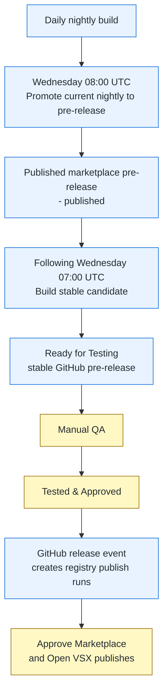
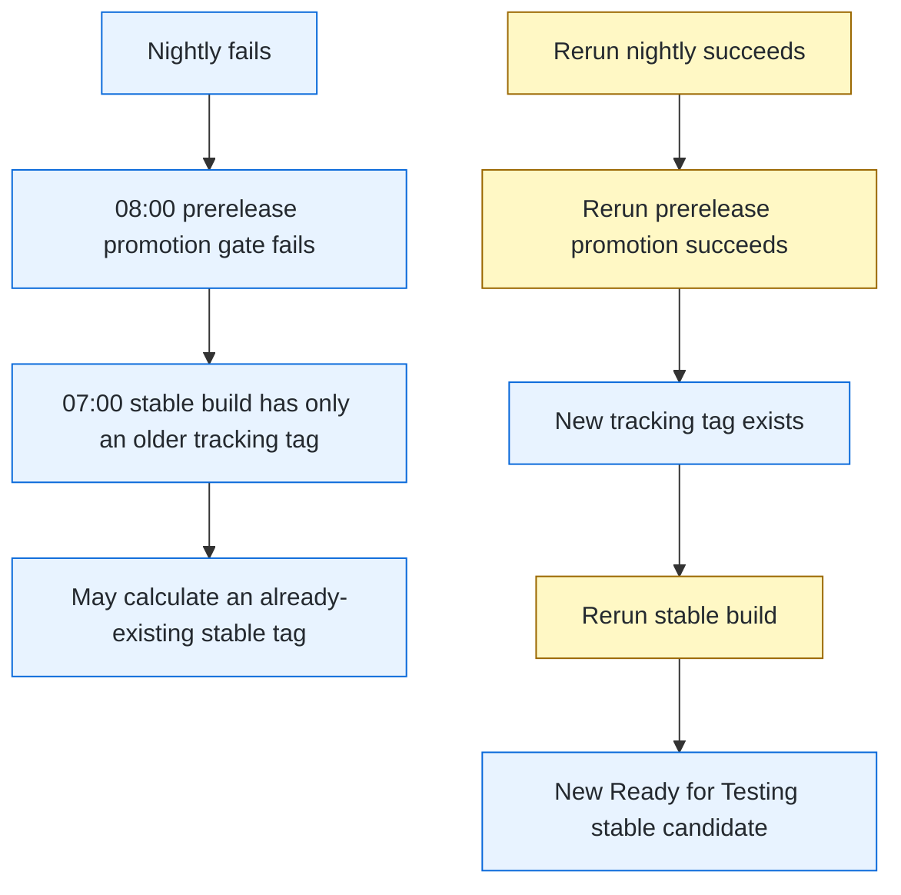

# Release Testing Guide

Operational runbook for the weekly release manager. It covers the normal
release train, manual QA, publication approvals, and recovery when a
prerequisite workflow fails.

## Release States

Four release artifacts have similar names but serve different purposes:

| Artifact | Example | Created by | Meaning |
|---|---|---|---|
| Nightly | `v68.5.5-nightly.develop.20261021` | `nightly.yml` | Daily build from `develop`. Not necessarily selected for the weekly train. |
| Published marketplace pre-release | Nightly title ends in `- published` | `promote-to-prerelease.yml` | Weekly prerelease published to both registries. It becomes the input to the following week's stable build. |
| Stable candidate | `Release 68.6.0 - Ready for Testing` | `build-github-release.yml` | Stable-version VSIX assets awaiting manual QA. |
| Approved stable release | `Release 68.6.0 - Tested & Approved` | Release manager | Stable candidate that passed QA and triggered stable registry publication. |

`Tested & Approved` is only valid for a stable candidate. Do not apply it to
a nightly or marketplace pre-release.

## Weekly Release Train



Blue steps are automated CI/CD. Yellow steps require release-manager action.

The scheduled workflow order is intentional:

1. At **07:00 UTC**, `build-github-release.yml` consumes the prior week's
   published marketplace pre-release. It creates the stable tag and assets,
   including the isolated `release-staging/vX.Y.0` build workspace and a
   `Ready for Testing` GitHub pre-release.
2. At **08:00 UTC**, `promote-to-prerelease.yml` promotes the newest
   CI-valid nightly. It creates the `marketplace-prerelease-*` tracking tag,
   publishes prerelease artifacts to both registries, and appends
   ` - published` to the nightly title.

The 08:00 pre-release is deliberately not consumed by the 07:00 build on the
same day. It receives a week of marketplace validation before becoming input
to a stable candidate.

### Happy-Path Example

```text
Week N, Wednesday 08:00
  v68.5.5-nightly.develop.20261021
  -> promoted to Marketplace and Open VSX as prerelease
  -> GitHub release title becomes
     "salesforcedx-vscode v68.5.5 (Nightly develop 20261021) - published"

Week N+1, Wednesday 07:00
  build-github-release.yml consumes v68.5.5-nightly.develop.20261021
  -> creates release-staging/v68.6.0 in its build workspace
  -> creates GitHub pre-release v68.6.0 titled
     "Release 68.6.0 - Ready for Testing"

After stable-candidate QA passes
  v68.6.0 title becomes "Release 68.6.0 - Tested & Approved"
  -> GitHub marks it as a full release and Latest
  -> creates one waiting publish workflow for Microsoft Marketplace
  -> creates one waiting publish workflow for Open VSX
```

Check those visible release-record clues with:

```bash
gh release list --repo forcedotcom/salesforcedx-vscode --limit 10
```

Expected rows for this example:

```text
TITLE                                                               TYPE         TAG NAME                          PUBLISHED
Release 68.6.0 - Ready for Testing                                  Pre-release  v68.6.0                           about 1 hour ago
salesforcedx-vscode v68.5.5 (Nightly develop 20261021) - published  Pre-release  v68.5.5-nightly.develop.20261021  about 3 hours ago
salesforcedx-vscode v68.5.4 (Nightly develop 20261020)              Pre-release  v68.5.4-nightly.develop.20261020  about 1 day ago
playwright-vscode-ext-v1.7.2                                                     playwright-vscode-ext-v1.7.2      about 4 days ago
Release 68.4.0 - Tested & Approved                                  Latest       v68.4.0                           about 4 days ago
salesforcedx-vscode v68.3.3 (Nightly develop 20261016)              Pre-release  v68.3.3-nightly.develop.20261016  about 5 days ago
```

The `Ready for Testing` and `Tested & Approved` rows are successive states of
the same stable tag; they do not exist simultaneously. The `- published`
nightly remains a pre-release and is the next stable build's input.

## Monday Checklist

At the start of the release-manager work week, inspect the train without
approving, cancelling, or dispatching anything:

1. Open the latest [Releasability Dashboard workflow run](https://github.com/forcedotcom/salesforcedx-vscode/actions/workflows/release-dashboard.yml).
   Its job summary presents the nightly, prerelease-promotion, stable-build,
   and per-registry publication states together with the current artifacts,
   derived blocker, and a read-only recovery recommendation. It refreshes after
   the scheduled nightly and Wednesday promotion; use **Run workflow** for a
   current snapshot during an incident.
   The dashboard's `develop` test-health section is intentionally strict about
   evidence: a failed current-commit build or unit check is a hard no, while a
   missing check is `not verified`, not a pass. The current unit/build workflows
   run on merged PR heads rather than direct `develop` pushes, so use this
   section as feeder evidence rather than asserting direct branch coverage.
2. Use the commands below when the dashboard links to a failed or ambiguous
   workflow and its logs need closer inspection.

```bash
gh release list --repo forcedotcom/salesforcedx-vscode --limit 15
gh run list --repo forcedotcom/salesforcedx-vscode --status waiting --limit 20 \
  --json databaseId,workflowName,displayTitle,createdAt,url
gh run list --repo forcedotcom/salesforcedx-vscode --workflow build-github-release.yml --limit 3
gh run list --repo forcedotcom/salesforcedx-vscode --workflow promote-to-prerelease.yml --limit 3
```

Expected signals:

- A prior stable release titled `Tested & Approved` may have exactly two
  waiting runs: one `Publish Release to Marketplace` and one `Publish in Open
  VSX Registry`. Their presence confirms that stable publication is ready for
  the Wednesday release ceremony; do not approve them during the Monday check.
- A successful promoted nightly has a title ending in `- published` and is a
  pre-release.
- The promoted nightly version must be greater than the stable release awaiting
  publication. For example, a published `v68.5.5-nightly.develop.20261021`
  is ahead of pending stable `v68.4.0`. If it is not ahead, stop and diagnose
  the release-train state before Wednesday.
- A successful stable build has a GitHub pre-release titled
  `Release X.Y.Z - Ready for Testing`.

For normal weekly releases, if duplicate publish runs exist, record their URLs
and defer handling them to the Wednesday release ceremony. At that time,
approve one Marketplace run and one Open VSX run; after the selected pair
succeeds, cancel the duplicate pair. Hotfixes require the explicit test-gated
runs in [Publish a Stable Hotfix](#publish-a-stable-hotfix), not an arbitrary pair.

## Testing Checklist

### 1. Select the Correct QA Artifact

`gh release download` without a tag downloads GitHub's latest full release.
It does not select a prerelease candidate.

```bash
gh release list --repo forcedotcom/salesforcedx-vscode --limit 10
```

Example output:

```text
TITLE                                                               TYPE         TAG NAME                          PUBLISHED
Release 68.6.0 - Ready for Testing                                  Pre-release  v68.6.0                           about 1 hour ago
salesforcedx-vscode v68.5.5 (Nightly develop 20261021) - published  Pre-release  v68.5.5-nightly.develop.20261021  about 3 hours ago
salesforcedx-vscode v68.5.4 (Nightly develop 20261020)              Pre-release  v68.5.4-nightly.develop.20261020  about 1 day ago
playwright-vscode-ext-v1.7.2                                                     playwright-vscode-ext-v1.7.2      about 4 days ago
Release 68.4.0 - Tested & Approved                                  Latest       v68.4.0                           about 4 days ago
salesforcedx-vscode v68.3.3 (Nightly develop 20261016)              Pre-release  v68.3.3-nightly.develop.20261016  about 5 days ago
```

Choose the tag that matches the QA stage:

- **Marketplace prerelease validation:** newest nightly row ending in
  `- published`.
- **Stable-candidate QA:** `Ready for Testing` stable tag, such as `v68.6.0`.

Download the selected tag explicitly:

```bash
# Example: QA a stable candidate
gh release download v68.6.0 --dir ~/Downloads/latestVSCode --pattern '*.vsix' --repo forcedotcom/salesforcedx-vscode
```

### 2. Install Extensions Locally

```bash
cd ~/Downloads/latestVSCode
find . -name "*.vsix" -exec code --install-extension {} \;
```

### 3. Run Manual QA Tests

Follow the required test cases in the team's [Release Testing Slack canvas](https://salesforce.enterprise.slack.com/docs/T092Z56AE/F0B7RLRUSRG). Create or use the release-specific testing document from that canvas, record the candidate tag being tested, and capture the pass/fail evidence there.

### 4. Record the Decision

**Stable candidate passes:** Record testing evidence, then follow
[Stable Release](#stable-release) to mark that stable tag `Tested & Approved`.

**Marketplace pre-release passes:** Record the evidence. It remains a
pre-release and is consumed by the following week's stable build.

**Tests fail:** Do not mark the stable candidate `Tested & Approved` and do
not approve its registry publication. Create or apply the needed fix, then
use the appropriate standard, patch, or emergency workflow to produce a new
candidate.

## Publishing to Marketplace

### Stable Release

Normal weekly releases only. For patches or candidates built from arbitrary
refs, use [Publish a Stable Hotfix](#publish-a-stable-hotfix).

First, promote the release from pre-release to a full release. This is required, not optional — the publish pipeline reads the release's `isPrerelease` flag and passes `--pre-release` to `vsce`, which fails outright since these VSIXs are packaged as stable. Also update the title to reflect testing passed, and mark it `--latest`:

```bash
gh release edit v67.12.0 --prerelease=false --title "Release 67.12.0 - Tested & Approved" --latest --repo forcedotcom/salesforcedx-vscode
```

This automatically fires both `publishVSCode.yml` and `publishOpenVSX.yml` via the `release: types: [released]` event (both still gated by the `publish` environment approval). If a run needs retrying, dispatch manually — these are two independent workflows, so dispatching one does not trigger the other:

```bash
# Trigger marketplace publish workflow
gh workflow run publishVSCode.yml \
  -f version="v67.12.0" \
  --repo forcedotcom/salesforcedx-vscode

# Trigger Open VSX publish workflow
gh workflow run publishOpenVSX.yml \
  -f release-tag="v67.12.0" \
  --repo forcedotcom/salesforcedx-vscode
```

Monitor the workflows at: https://github.com/forcedotcom/salesforcedx-vscode/actions/workflows/publishVSCode.yml and https://github.com/forcedotcom/salesforcedx-vscode/actions/workflows/publishOpenVSX.yml

### Pre-release (Emergency Hotfix)

Use [Emergency Pre-release Workflow](#emergency-pre-release-workflow), including
the source version bump, QA, and `isHotfix=true` promotion gate.

## Post-Publishing Cleanup

### Delete Isolated Release Branch

Stable releases are built on `release-staging/v{version}` branches that should NOT be merged to develop:

```bash
# Delete the staging branch after publishing
git push origin --delete release-staging/v67.12.0
```

**Important:** Only cherry-pick functional fixes to develop, NOT the version-bump commit.

### Cherry-pick Functional Fixes

Merge functional fixes through a feature-branch PR to `develop`, separately
from release backports. Cherry-pick only reviewed functional-fix commits;
exclude release-only version bumps and tooling commits.

## Patch Release Workflow

Canonical hotfix runbook for already-cut stable and prerelease versions.
Build, package versioning, QA, and marketplace publication are separate steps.
The build workflows create GitHub releases/assets; they do not publish to registries.

### Confirm Scope and Sources

Before any mutation, show the release manager the exact source tags/SHAs,
reviewed fix commits, target versions, changelog scope, pending publication
runs, and commands. Get explicit confirmation for builds, publication,
cancellations, and approvals; a request to investigate is not authorization.

- Check both registries and existing GitHub tags/releases. Every target version
  must be unused, including versions built but never marketplace-published.
- Existing release artifacts are immutable for recovery: never delete/recreate
  a release, move a tag, or replace assets to reuse its version. Choose the next
  unused patch, even if a workflow error suggests deleting a tag for retry.
- Use separate branches/worktrees for each release line. Stable starts at the
  exact **released stable tag**, not its source nightly; that preserves shipped
  release changes. Prerelease starts at the exact published prerelease tag.
- Cherry-pick only the reviewed fix, not all of `develop`. Merge the fix to
  `develop` separately for long-term protection; exclude release-only commits.
- Install dependencies in each checkout (`pnpm install --frozen-lockfile`),
  then run `pnpm compile` and `pnpm test`. Never reuse another checkout's
  `node_modules`. Keep hooks and quality gates enabled.

Illustration only; verify live versions before choosing targets:

| Release line | Exact source | Immediate hotfix |
|---|---|---|
| Stable | `v68.4.0` | `v68.4.1` |
| Published prerelease | `v68.5.5-nightly.develop.20261021` | `v68.5.6` |

These are **2 builds**. Replacing an already-built `v68.6.0` candidate is a
separate later decision, not an automatic third hotfix build.

### Build a Stable Patch

After scope confirmation, create the release-base branch from the exact stable tag:

```bash
gh workflow run create-patch-release-branch.yml --ref develop \
  -f baseVersion="68.4.0" \
  --repo forcedotcom/salesforcedx-vscode
```

This creates `release-base/v68.4.x` and copies version helpers from `develop`.
Inspect an existing branch before reusing it; do not recreate it blindly.
In its own checkout, install dependencies, cherry-pick only the reviewed fix,
prepare `packages/salesforcedx-vscode/CHANGELOG.md` for the patch, test, and
commit/push. Then, after confirming the calculated version is unused:

```bash
gh workflow run build-and-release-patch-branch.yml --ref develop \
  -f releaseBranch="release-base/v68.4.x" \
  --repo forcedotcom/salesforcedx-vscode
```

Input is **`releaseBranch`**, with `release-base/vX.Y.x` format. The workflow
increments the highest `vX.Y.Z` tag (not just published versions), updates and
commits package/lockfile versions, then tags/builds stable-packaged VSIXs.
Download/test the new tag using [Testing Checklist](#testing-checklist), then
follow [Publish a Stable Hotfix](#publish-a-stable-hotfix).

### Publish a Stable Hotfix

**Current workflow limitation/workaround:** both `publishVSCode.yml` and
`publishOpenVSX.yml` trigger on `release: released`, but `gate-check` runs only
when `github.event.inputs.isHotfix == 'true'`. Release events have no dispatch
inputs, so those runs **skip compile/test**, and publication accepts a skipped
gate. The human `publish` environment approval remains; it does not replace tests.

1. Record manual QA evidence for the exact stable-packaged VSIXs. Include the
   regression scenario in the affected runtime; e.g., an anonymous Apex SOAP
   fix requires real Web Console anonymous Apex execution, not inferred success.
2. After explicit QA/publication confirmation, mark the GitHub release stable:

```bash
gh release edit v68.4.1 --prerelease=false \
  --title "Release 68.4.1 - Tested & Approved" --latest \
  --repo forcedotcom/salesforcedx-vscode
```

The publishers read GitHub's `isPrerelease` flag. Leaving it `true` requests
`--pre-release`, which is incompatible with stable-packaged VSIXs.

3. Identify the 2 automatically created release-event runs. **Do not approve
   them.** After explicit confirmation, cancel them or leave them unapproved.
4. After explicit confirmation, manually dispatch **both** registries from
   `develop` with the hotfix gate enabled:

```bash
gh workflow run publishVSCode.yml --ref develop \
  -f version="v68.4.1" -f isHotfix=true \
  --repo forcedotcom/salesforcedx-vscode
gh workflow run publishOpenVSX.yml --ref develop \
  -f release-tag="v68.4.1" -f isHotfix=true \
  --repo forcedotcom/salesforcedx-vscode
```

5. Approve only these explicit hotfix runs after confirmation. Their `publish`
   environment approval precedes `gate-check`; require each exact-tag
   compile/test gate to succeed before publication. Stop on failure.
6. Verify the intended version/channel in **both** registries. They are
   independent: dispatching Microsoft publication does not trigger Open VSX.

This is the hotfix exception to the weekly rule against duplicate dispatches;
ordinary weekly releases use their automatically created runs.

### Changelog-Only Correction After a VSIX Exists

The same immutable-version rule applies, even to an unpublished candidate.
Branch from the affected release tag, commit the corrected package changelog
with its new version header, and build a new unused patch:

```bash
gh workflow run build-github-release.yml --ref develop \
  -f startFromRef="<changelog-correction-commit-sha>" \
  -f releaseVersion="68.6.1" \
  --repo forcedotcom/salesforcedx-vscode
```

Stable mode updates package versions on an isolated build branch. QA the new
tag, then use [Publish a Stable Hotfix](#publish-a-stable-hotfix), not the
ungated release-event runs. Merge the correction to `develop` separately;
exclude the release-only version bump.

## Emergency Pre-release Workflow

Apply [Confirm Scope and Sources](#confirm-scope-and-sources) first. In a
separate checkout from the exact published prerelease tag, cherry-pick only
the reviewed fix. **Emergency mode does not bump package versions.**
`releaseVersion` names the tag/release only; it does not change VSIX versions.
Choose an unused version ahead of both registries, update source versions,
and commit before building (illustrative version):

```bash
node scripts/update-release-versions.js 68.5.6
git add packages/*/package.json pnpm-lock.yaml
git commit -m "chore: bump emergency prerelease versions to 68.5.6"
```

Install/test the updated checkout and push the source commit with normal
hooks. Verify the publishable package versions equal `68.5.6`, then build
that exact SHA after confirmation:

```bash
gh workflow run build-github-release.yml --ref develop \
  -f emergencyPrerelease=true \
  -f startFromRef="<version-bumped-hotfix-commit-sha>" \
  -f releaseVersion="68.5.6" \
  --repo forcedotcom/salesforcedx-vscode
```

This creates `v68.5.6` with **prerelease-packaged** VSIXs, not a marketplace
publication. Download/test that exact tag, verify the embedded versions, and
record regression QA evidence (including real Web Console anonymous Apex for
that fix). After explicit QA/publication confirmation:

```bash
gh workflow run promote-to-prerelease.yml --ref develop \
  -f releaseTag="v68.5.6" -f isHotfix=true \
  --repo forcedotcom/salesforcedx-vscode
```

`isHotfix=true` runs compile/test against the exact source commit; it is
required, not a test bypass. Promotion publishes to **both** registries.
Verify both live prerelease versions. Keep this GitHub release a prerelease;
never mark it `Tested & Approved` or flip it stable. Stable needs a separate
stable-packaged build.

Promotion generates a changelog delta from the previous tracking tag, often
only the hotfix, and injects it into the pack VSIX before publication. It does
not preserve the original candidate's full release notes automatically. This
workflow-owned injection is not permission to replace assets as recovery.

### Later Stable Candidate from a Patched Prerelease

A successful hotfix promotion does **not** fix stable auto-detection:
`build-github-release.yml` walks `marketplace-prerelease-*` tags, extracts each
version, and searches for `vVERSION-nightly.develop.*`. A hotfix `v68.5.6`
without such a nightly is skipped; an older source can be selected.
`prereleaseTag` accepts only nightly-formatted tags, not `v68.5.6`.

After a separate source/version decision, branch from the patched prerelease
source, prepare/commit the package changelog with the **original candidate's
changes plus the fix**, and label it for the intended stable version.
Arbitrary `startFromRef` builds skip normal nightly changelog relabeling;
neither that build nor promotion reconstructs those release notes for you.

If `v68.6.0` already exists, leave its tag/assets unchanged, even if unpublished
or already approved. With explicit confirmation, hold/cancel its superseded
pending publications. Use an unused successor, e.g. `68.6.1`:

```bash
gh workflow run build-github-release.yml --ref develop \
  -f startFromRef="<patched-source-with-complete-changelog-sha>" \
  -f releaseVersion="68.6.1" \
  --repo forcedotcom/salesforcedx-vscode
```

Stable mode bumps package versions on its isolated build branch. Verify the
source/fix/changelog and embedded versions in the new assets, QA them, then
follow [Publish a Stable Hotfix](#publish-a-stable-hotfix). Building this
successor never retroactively fixes an existing candidate.

## Troubleshooting

### Wednesday Dependency Failures

Weekly nightly recovery only. If the needed source is an emergency hotfix or
the target candidate already exists, use [Later Stable Candidate from a Patched Prerelease](#later-stable-candidate-from-a-patched-prerelease).
A hotfix tracking tag does not guarantee that default source detection uses it.

The stable build depends on a promoted prerelease tracking tag, and promotion
depends on a successful nightly build. A failed prerequisite can leave the
scheduled stable build with last week's input.



Blue nodes are CI/CD state or outcomes. Yellow nodes require release-manager
intervention after confirming the recovery sequence.

| Symptom | What it means | Safe recovery |
|---|---|---|
| `promote-to-prerelease.yml` gate check fails | The selected nightly did not successfully package and create its GitHub release. | Repair or rerun `nightly.yml`, then rerun promotion and confirm it ends with `- published`. |
| `build-github-release.yml` resolves an old nightly | The newer prerelease promotion was missing when the stable build started. | Complete promotion recovery first. Do not rerun the stable build until a new tracking tag exists. |
| Stable build fails with `tag 'vX.Y.Z' already exists` | It calculated a stable version already created from stale prerequisite state. | After promotion succeeds, rerun the stable build with default inputs. Confirm its log resolves the intended new published nightly and calculates the expected new stable version. |
| No `Ready for Testing` release after a successful promotion | The 07:00 stable-build window already passed before the promotion was repaired. | Rerun `build-github-release.yml` only after verifying the promotion succeeded and the expected tracking state exists. |

Example recovery from a transient nightly failure:

```text
1. nightly.yml fails.
2. 08:00 promotion fails its CI gate because the nightly package/release checks failed.
3. 07:00 stable build has old tracking state and attempts existing v68.4.0.
4. Rerun nightly.yml successfully.
5. Rerun promote-to-prerelease.yml successfully; v68.5.5 is now - published.
6. Rerun build-github-release.yml with default inputs.
7. Confirm the new run resolves v68.5.5 and calculates v68.6.0.
8. QA the resulting Release 68.6.0 - Ready for Testing candidate.
```

Before any recovery dispatch, verify the source and expected result with the
release manager. Do not use `startFromRef` for routine recovery: it bypasses
the normal nightly validation path and is intended for emergency workflows.

### VSIX Installation Fails

- Check VS Code version compatibility
- Try uninstalling old version first: `code --uninstall-extension salesforce.salesforcedx-vscode`
- Check extension logs: View → Output → Salesforce CLI

### Tests Reveal Critical Bug

1. **Stop the release** - Do not publish to marketplace
2. Create hotfix branch
3. Build new pre-release with bumped version
4. Retest completely

### Workflow Fails

Check common issues:
- Secrets configured correctly (VSCE_PAT, IDEE_GH_TOKEN)
- Release tag format correct (v{major}.{minor}.{patch})
- No naming conflicts with existing releases
- Follow [Wednesday Dependency Failures](#wednesday-dependency-failures) before
  rerunning a scheduled workflow. A retry with stale prerequisite state can
  recreate an existing version rather than the needed next stable candidate.

## Reference

- Release-manager assistant workflow: [SKILL.md](../.claude/skills/release/SKILL.md)
- Publishing details: [publishing.md](../contributing/publishing.md)
- Pipeline architecture: [release-workflow-architecture.md](release-workflow-architecture.md)
