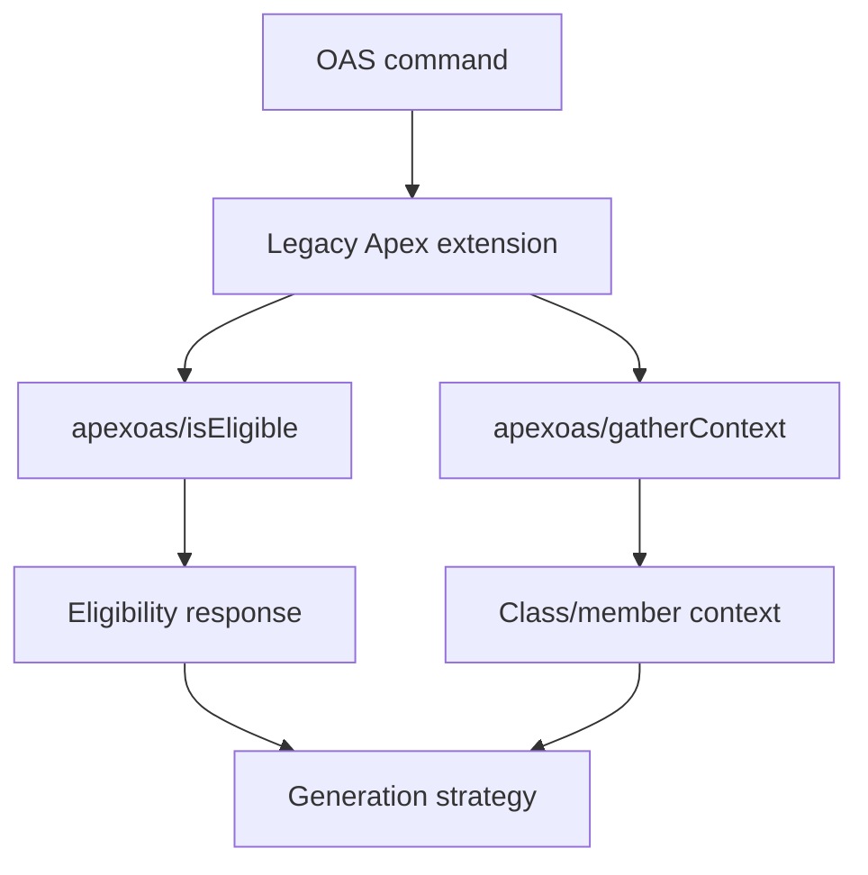
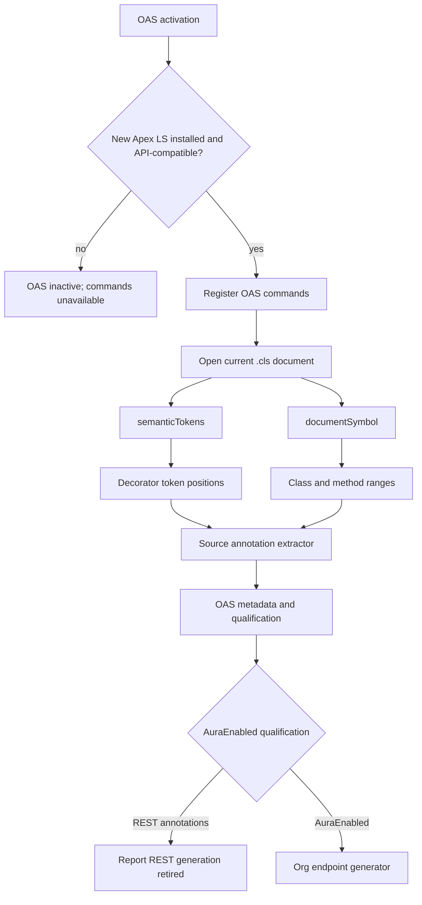

# W-24703759 - Migrate OAS metadata to the new Apex language server

## Goal

Remove the OAS extension's dependency on the legacy Apex extension and Jorje-only `apexoas/isEligible` and `apexoas/gatherContext` requests. Use the public API of `salesforce.apex-language-server-extension` to analyze the current Apex file.

## REST generation retirement

The former Apex REST (`@RestResource` / `@Http*`) generation path depended on an unavailable LLM integration and is retired rather than migrated. The OAS extension now generates only for AuraEnabled classes, rejects any REST annotations with a dedicated retirement message, and writes `AuraEnabled` provider metadata when replacing an existing generated ESR. Existing `ApexRest` ESR documents remain valid inputs to the validation command.

OAS activation is gated by all of the following:

- New Apex LS extension is installed.
- Extension activates successfully.
- Exported `client` supplies callable `semanticTokens` and `documentSymbol` APIs.
- The command-time request confirms full semantic-token support and returns document symbols for the requested class.

No legacy-Apex-LS fallback. If the gate fails, OAS remains inactive and its generation commands are not registered. OAS generation supports AuraEnabled classes only; Apex REST annotations are rejected before generation because their retired LLM dependency is no longer available.

Semantic-token capability and document-symbol results are file-specific and cannot be validated during activation. A command-time failure after successful activation surfaces an OAS error and does not fall back to Jorje.

## Current flow

- `packages/salesforcedx-vscode-apex-oas/src/services/apexMetadataService.ts`
  - Activates `salesforce.salesforcedx-vscode-apex`.
  - Waits for `languageClientManager` readiness.
  - Calls exported `isOpenAPIEligible` and `gatherOpenAPIContext`.
- `packages/salesforcedx-vscode-apex-oas/src/commands/metadataOrchestrator.ts`
  - Builds old endpoint payloads, validates response symbols, gathers context.
- `packages/salesforcedx-vscode-apex-oas/src/commands/apexActionController.ts`
  - Uses eligibility and context before strategy selection.

Legacy endpoint behavior to replace:

- Qualification: class/member modifiers, REST/Aura annotations, constructor filtering, configured access rules.
- Context: class/method ranges, class and method annotations, class documentation, class name.
- OAS does not currently consume legacy inheritance/interface/property/relationship context for generation.

## Target flow

New LS APIs:

- Extension ID: `salesforce.apex-language-server-extension`.
- Activation export: `client` from `packages/apex-lsp-vscode-extension/src/extension.ts` in `apex-ls-mywork`.
- `client.semanticTokens({ textDocument: { uri } })`:
  - Standard `textDocument/semanticTokens/full`.
  - Returns decoded token spans: line, character, length, token type, modifiers.
  - Annotation heads are `decorator` tokens.
- `client.documentSymbol({ textDocument: { uri } })`:
  - Standard `textDocument/documentSymbol`.
  - Supplies hierarchical class/method ranges for source correlation and method extraction.

## Design constraints

- Consume the new LS public API only. OAS must not cast to or import `ApexClientCore`.
- Consume new-LS standard-LSP methods through the guarded extension-export pattern established by Replay Debugger. `W-24769916` remains follow-up API hardening; OAS does not import or cast to `ApexClientCore`.
- Preserve all command entry points: Project Explorer, editor context menu, and Command Palette. Open the target with `workspace.openTextDocument` without revealing it so the new LS receives document state; prefer the resulting/current buffer text and fall back to a filesystem read only if VS Code does not provide it.
- Use document symbols as declaration/range authority and semantic tokens as parser-recognized anchors for annotations and declaration syntax. Extract the text of bounded declaration prefixes from the current document for Apex-specific modifiers that the standard LSP legend does not model.
- Use a bounded source extractor for annotation arguments and documentation. Do not create a second Apex semantic compiler in OAS.
- Keep OAS-specific contracts local to the OAS extension. Do not retain old Jorje endpoint schemas under new names.
- Preserve Aura, mixed-framework, and ineligible-class outcomes. Report a dedicated error for retired REST generation.

## Phase 1 - New Apex LS public API

Repository: `/Users/peter.hale/git/apex-ls-mywork`

Follow-up: `W-24769916` — expose `semanticTokens` and `documentSymbol` through the established `ApexExtensionApi.client` / `ApexClient` public interface.

### 1.1 Extend the established client contract

Files:

- Modify: `packages/apex-lsp-vscode-extension/src/extension.ts`
- Modify: relevant extension/client contract tests

Steps:

1. Add `semanticTokens` and `documentSymbol` to the established public `ApexClient` interface exposed by `ApexExtensionApi.client`.
2. Preserve current breakpoint and feature-state consumers.
3. Add compile-time/API tests showing a consumer can call:
   - `client.semanticTokens({ textDocument: { uri } })`
   - `client.documentSymbol({ textDocument: { uri } })`
4. Keep the existing method-level client tests as request/response coverage:
   - semantic-token capability absence returns `undefined` without making a request;
   - a negotiated full provider sends `textDocument/semanticTokens/full` and decodes using the negotiated legend;
   - document symbols send `textDocument/documentSymbol`.

Acceptance:

- The established public extension client interface advertises both required standard-LSP methods without OAS depending on implementation types or structural casts.

## Phase 2 - OAS activation gate and dependency switch

Files:

- Modify: `packages/salesforcedx-vscode-apex-oas/package.json`
- Modify: `packages/salesforcedx-vscode-apex-oas/src/index.ts`
- Modify/add: OAS activation and extension-export tests
- Delete/replace: `packages/salesforcedx-vscode-apex-oas/src/services/apexMetadataService.ts`

### 2.1 Replace extension dependencies

1. Remove `salesforce.salesforcedx-vscode-apex` from OAS `extensionDependencies`.
2. Add `salesforce.apex-language-server-extension`.
3. Remove the OAS development dependency on `salesforcedx-vscode-apex` when no source/test imports remain.
4. Refresh the workspace lockfile through the repository package manager if dependency metadata changes require it.

Status: completed. OAS now declares `salesforce.apex-language-server-extension` and has no legacy Apex runtime dependency.

### 2.2 Gate OAS activation

1. Resolve the new LS extension with `getExtensionExports` during OAS activation, before command registration, using the typed client interface delivered by `W-24769916`.
2. The activation probe must activate the dependency if VS Code has not yet activated it.
3. On missing extension, dependency activation failure, missing `client`, or missing required API:
   - do not register OAS commands;
   - emit a concise OAS output-channel/telemetry diagnostic identifying the failed prerequisite;
   - complete OAS activation without throwing, so the extension host remains healthy.
4. Do not activate or consult `salesforce.salesforcedx-vscode-apex` as a fallback.
5. Retain a service layer for command-time calls, but construct it from the activation-validated new-LS client rather than resolving the legacy Apex extension per request.

Status: completed with the Replay Debugger model. Activation resolves the Apex LS export through a narrow runtime schema for `semanticTokens` and `documentSymbol`; missing/incompatible exports leave OAS commands unregistered without failing the extension host.

Tests:

- missing new LS extension: activation completes, commands not registered;
- dependency activation rejects: activation completes, commands not registered;
- missing `semanticTokens` or `documentSymbol`: activation completes, commands not registered;
- valid export: commands register exactly once;
- old Apex extension is neither requested nor required.

Status: unit coverage verifies missing and activation-failed Apex LS exports plus guarded standard-LSP analysis. Command registration coverage remains to be added; existing Playwright specs cover Explorer, editor context-menu, and Command Palette paths but are skipped because REST generation still depends on the separate unavailable A4V LLM service.

Acceptance:

- OAS commands cannot be invoked in an unsupported editor configuration.
- A valid new LS dependency produces the same OAS command registrations as today.

## Phase 3 - OAS-owned source metadata

Files:

- Add: `packages/salesforcedx-vscode-apex-oas/src/oas/apexSourceMetadata.ts`
- Add: `packages/salesforcedx-vscode-apex-oas/src/oas/apexSourceMetadataSchemas.ts` if types are large enough to warrant separation
- Add: focused unit tests beside existing OAS tests
- Modify: `packages/salesforcedx-vscode-apex-oas/src/commands/metadataOrchestrator.ts`
- Modify: `packages/salesforcedx-vscode-apex-oas/src/oasUtils.ts`

### 3.1 Local contracts

Define OAS-owned types containing only data consumed by OAS:

- `OasAnnotation`: name, parameter map, source range.
- `OasClassContext`: name, annotations, documentation comment, declaration range, class `DocumentSymbol`.
- `OasMethodContext`: name, annotations, documentation comment, `DocumentSymbol`, and extracted declaration modifiers needed for qualification.
- `OasAnalysis`: resource URI, document text, class context, methods, REST-eligible methods, Aura-eligible methods.

Do not carry forward unused legacy endpoint fields:

- interfaces;
- inherited class details;
- property details;
- relationship placeholder data;
- method parameter/return-type data.

### 3.2 Retrieve standard-LSP data

1. Resolve the target URI using the existing command semantics: the Explorer target, editor-context resource, or current editor for Command Palette invocation.
2. Use the in-memory `TextDocument` content when `vscode.workspace.textDocuments` already contains that URI, so unsaved changes win.
3. Otherwise, read the target file with a non-revealing filesystem read. Do not call `openTextDocument` merely to obtain source text.
4. Use `uri.toString()` for all LSP requests.
5. Request semantic tokens and document symbols from the activation-gated client.
6. Handle semantic-token `undefined` as unavailable capability, not an empty annotation set.
7. Require `DocumentSymbol[]`; reject or explicitly normalize `SymbolInformation[]` because OAS needs hierarchy/ranges.
8. Retry only the known document-state registration race. Bound the retry schedule and preserve non-transient errors.
9. Return the resolved source text with tokens and symbols as one analysis input. For open documents this is the editor buffer; for unopened Explorer targets it is the file content read for that invocation.

### 3.3 Correlate tokens and declarations

1. Identify the outermost class symbol and immediate method children.
2. Filter semantic tokens to `tokenType === 'decorator'`.
3. Bind each decorator to the nearest following declaration in the same lexical scope:
   - class-level decorators bind to the outer class;
   - method-level decorators bind to an immediate method child;
   - decorators inside nested classes do not qualify the outer class.
4. Preserve token and symbol ranges in OAS local metadata for diagnostics and source slicing.

### 3.4 Extract annotation parameters, comments, and modifiers

Implement a source extractor over the current document buffer:

- Parse annotation name at each decorator span.
- Parse optional parenthesized arguments after the name.
- Support multiline arguments, nested parentheses, quoted strings, escaped quotes, and commas in strings.
- Produce named parameters without modifying their source values; `urlMapping` must preserve existing behavior.
- Ignore annotation-like text inside strings and comments by starting only from semantic-token locations.
- Extract doc comments immediately preceding class and method declarations from the same current `TextDocument` used for semantic tokens and document symbols.
- Associate a comment with a declaration only when it is the contiguous preceding documentation block inside the declaration's containing symbol range. Do not use proximity heuristics, and do not collect trailing/inline comments.
- Do not add a new Apex-LS comment API or parse `hover`, completion, or signature-help Markdown. New-LS comment capture remains an internal compiler feature; OAS needs only the selected document's class documentation for the REST prompt.
- Extract declaration modifiers from the bounded current-document prefix preceding the parser-recognized declaration token. This includes `global`/`public`/`private`/`protected`, `static`, constructor identity, and static initializer identity. Semantic tokens and document-symbol hierarchy anchor the declaration and bound extraction; OAS must not search arbitrary text or independently parse an Apex file.

Tests:

- bare `@AuraEnabled`;
- `@RestResource(urlMapping='/v1/foo/*')`;
- multiline `@RestResource` arguments;
- stacked annotations;
- quotes, escaped quotes, nested parentheses, and comma-containing values;
- `@` in comments and strings is ignored;
- contiguous class doc comment is included in the REST class prompt;
- method doc comments, ordinary block comments, trailing comments, and comments from nested declarations do not become the outer class documentation;
- annotations on nested classes do not affect outer-class qualification;
- current unsaved document text, rather than disk text, drives analysis.

Acceptance:

- OAS can derive the annotation and source data it actually consumes from public standard-LSP responses plus the current text document.

## Phase 4 - Qualification replacement

Files:

- Replace: `packages/salesforcedx-vscode-apex-oas/src/commands/metadataOrchestrator.ts`
- Modify: `packages/salesforcedx-vscode-apex-oas/src/commands/apexActionController.ts`
- Modify: `packages/salesforcedx-vscode-apex-oas/README.md`
- Modify: `packages/salesforcedx-vscode-apex-oas/src/oasUtils.ts`
- Add: qualification unit tests

### 4.0 OAS-local implementation progress

Implemented without changing the Apex LS client API:

- `apexSourceMetadata.ts` derives OAS-owned class/method annotations, parameters, declaration modifiers, constructors, and immediate method membership from parser-recognized token spans, document symbols, and current document text.
- `oasQualification.ts` classifies REST, AuraEnabled, mixed-framework, and invalid inputs without legacy endpoint data. REST selection excludes constructors and non-static HTTP methods; Aura selection excludes constructors.
- The command adapter opens the selected resource without revealing it, retries the documented new-LS document-state race, requests semantic tokens and hierarchical document symbols, and applies package-directory eligibility before qualification.
- Focused unit coverage verifies annotation parsing, modifier extraction, nested-member exclusion, REST/Aura selection, mixed-framework rejection, and invalid qualification reasons.

Completed integration:

- `metadataOrchestrator.ts`, generators, processors, extension dependencies, and activation consume OAS-local analysis from the guarded Apex LS export.
- Legacy `apexoas/isEligible` and `apexoas/gatherContext` runtime calls have been removed.

### 4.1 Replace old endpoint orchestration

1. Remove old `ApexOASEligiblePayload` request construction.
2. Remove `ApexMetadataService.isOpenAPIEligible` and `gatherOpenAPIContext` calls.
3. Replace `validateMetadata` and `gatherContext` with one new-LS analysis operation returning `OasAnalysis`.
4. Preserve Effect tagged errors for:
   - unresolved resource URI;
   - unavailable/incompatible new LS API;
   - unresolved or unreadable source resource;
   - no class declaration;
   - no qualifying OAS framework.

### 4.2 Framework qualification

Implement the currently visible product rules:

- REST:
  - class-level `@RestResource`;
  - at least 1 non-constructor, static method carrying `@HttpGet`, `@HttpPost`, `@HttpPut`, `@HttpPatch`, or `@HttpDelete`;
  - class access rules required for REST generation, including `global` if that remains the intended parity rule.
- Aura:
  - no class-level annotations;
  - at least 1 non-constructor method carrying `@AuraEnabled`;
  - configured method access rules, if still required.
- Mixed:
  - any REST class/method indicator plus `@AuraEnabled` method indicator fails with the current mixed-framework message.
- Invalid:
  - preserve targeted explanations for missing class REST annotation, missing HTTP method annotation, class annotation blocking Aura, and no qualifying method annotations.

### 4.3 Replace legacy OAS metadata with new client APIs

The legacy `apexoas/isEligible` and `apexoas/gatherContext` endpoints mixed syntax, declaration structure, project configuration, and semantic facts in one response. The replacement composes the same required OAS inputs from the new LS public client, existing services, and bounded extraction from the current document.

For this migration, standard LSP semantic tokens provide parser-recognized token locations and declared token kinds, while `documentSymbol` provides hierarchy and declaration/body ranges. LSP 3.17 semantic-token modifiers are not an Apex visibility/access contract. OAS uses those standard responses to anchor a bounded extraction of the selected declaration prefix in the current text document for Apex-specific modifiers such as `global`, `public`, `private`, `protected`, and `static`, plus constructor/static-initializer identification. OAS must not search arbitrary file text or independently parse an Apex file.

| Legacy OAS requirement | Replacement source | OAS use |
| --- | --- | --- |
| Annotation name and source position | `semanticTokens`: parser-recognized `decorator` span | Find REST, HTTP, and Aura annotations without comment/string false positives |
| Annotation parameter values, including `@RestResource(urlMapping=...)` | Current `TextDocument`, anchored at the decorator span | Parse one annotation's balanced argument list and preserve raw parameter values |
| Annotation owner: outer class, method, property, nested class | `documentSymbol`: hierarchical class/member ranges | Bind each decorator to its following declaration in the same scope |
| Class/method/property declarations | `semanticTokens`: declaration tokens; `documentSymbol`: hierarchy/ranges | Select the outer class and declared members; reject a flat `SymbolInformation[]` result |
| Access and declaration modifiers, including `global`, `public`, `private`, `protected`, `static`, constructors, and static initializers | Current `TextDocument` declaration prefix bounded by semantic declaration span and `documentSymbol` range | Apply qualification from parser-anchored text; do not use hover or a custom API |
| Class and method names | Current `TextDocument` at semantic declaration spans | Read source names after semantic-token classification; do not parse `DocumentSymbol.name` presentation text |
| Method range and current-buffer source for REST prompt | `documentSymbol.range` plus current `TextDocument` | Slice the selected eligible method body without a disk read |
| Method parameter declarations/type references | `semanticTokens` | Available for future prompt enrichment, but not used by current OAS generation |
| Documentation comments | Current `TextDocument` plus `documentSymbol` hierarchy/ranges | Associate only a contiguous preceding documentation block with its declaration |
| Class namespace eligibility | `ProjectService.getProjectNamespace()` and `ensureInPackageDirectories()` | Read canonical `sfdx-project.json` namespace and validate package-directory membership per command |
| Whether the declared type is an sObject | Architecture decision in section 4.3.5 | Remove the legacy check, or replace the composed approach with a complete new-LS OAS metadata API; do not add a one-field command |

### 4.3.1 Required client requests

Use only these requests for the first-party OAS source model:

- `textDocument/semanticTokens/full`
  - Finds parser-recognized annotation heads without lexical false positives from comments or strings.
  - Identifies class, method, property, field, and other declaration/reference tokens.
  - Identifies parameter declarations and type/reference/literal spans inside annotation arguments and method signatures.
   - Supplies parser-recognized annotation-head and declaration-identifier positions. The standard protocol permits `keyword` tokens, but OAS must not require modifier-keyword spans because the current new-LS declaration-token mapper emits declaration identifier spans rather than individual `global`/`public`/`static` syntax spans.
   - Does not define Apex-specific semantic-token modifiers for access, constructor, or static-initializer identity. OAS extracts those local syntax facts only from the declaration prefix bounded by token spans and `documentSymbol` ranges.
   - Does not group spans into an annotation-parameter object or an ordered method-signature object. It also does not encode declaration ownership/body range, comments, or semantic resolution.
- `textDocument/documentSymbol`
  - Supplies the outer-class/method hierarchy, `SymbolKind`, declaration `range`, and `selectionRange`.
  - Establishes annotation ownership and method slicing boundaries.
  - Its formatted `name` may include a method signature, but OAS must not parse that presentation string.
### 4.3.2 Standard LSP requests not used

The LSP 3.17 protocol defines further requests, but none supersede the semantic-token plus document-symbol model for the current OAS source analysis.

| Request | What it could provide | Decision for OAS |
| --- | --- | --- |
| `textDocument/selectionRange` | Nested syntactic selections for supplied cursor positions | Not useful. OAS already has declaration/body ranges from `documentSymbol`; selection ranges do not return annotation arguments, comments, or semantic classification. |
| `textDocument/signatureHelp` | Signature and parameter metadata for an invocation at a cursor | Not useful for declaration analysis. It operates on a call-site context, not a method declaration, and cannot associate `@HttpGet`/`@AuraEnabled` with the declaration. |
| `textDocument/typeDefinition` | Definition of the type at a selected reference | Not useful for the class currently being generated. Project namespace comes from `sfdx-project.json`; type definition cannot classify the current declaration as an sObject. |
| `textDocument/implementation` | Implementations for a selected interface/abstract member | Not useful. REST/Aura qualification is a local declaration/annotation decision; implementation lookup adds cross-file work without filling a required field. |
| `textDocument/prepareTypeHierarchy`, `typeHierarchy/supertypes`, `typeHierarchy/subtypes` | Related types and hierarchy nodes | Out of scope. Current OAS qualification and generation analyze only the selected class and its declared members; inheritance/interface traversal is not part of this migration. |
| `textDocument/prepareCallHierarchy`, call hierarchy requests | Incoming/outgoing calls | Not relevant to OpenAPI eligibility or source context. |
| `textDocument/inlayHint` | Optional presentation hints such as inferred types/parameter names | Do not use. Hints are optional UI data, may be absent, and are not a stable declaration metadata contract. |
| `textDocument/moniker` | Cross-tool symbol identity at a selected position | Not implemented/advertised for the new Apex LS and is not a workspace-namespace or sObject-classification API. |
| `workspace/symbol` | Workspace search results | Not an authority for the open document's current unsaved state; returns discovery results, not complete declaration metadata. |
| pull diagnostics | Validation findings | Diagnostics prove invalid code but do not return the structured eligibility facts OAS needs. Use only for normal editor diagnostics, not metadata extraction. |
| `textDocument/foldingRange`, `linkedEditingRange`, document links/highlights | Editor navigation/presentation ranges | No required OAS metadata. |

The first implementation uses exactly `semanticTokens` and `documentSymbol`, plus the current `TextDocument` contents. Add another standard request only when a concrete OAS field is unavailable from those inputs and its protocol response exposes that field as a structured, capability-advertised contract.

### 4.3.3 Current-document enrichment

The following are syntactic facts and may be extracted locally from the current text document because semantic tokens and document symbols anchor the extraction:

- annotation names and argument text;
- class/method ownership of annotations;
- documentation comments immediately preceding a declaration;
- method/class declaration ranges;
- REST HTTP-verb and Aura annotation presence.

Use semantic-token spans and document-symbol ranges as the source of truth for declaration boundaries. Extract only the selected declaration prefix from the current document for visibility and declaration modifiers; there is no unbounded modifier search or fallback to hover, Markdown presentation data, or legacy metadata.

Documentation comment decision: use the current document text plus `DocumentSymbol` hierarchy/ranges. Although the new LS can capture and associate comments internally when its compiler setting is enabled, none of its currently exposed public client methods returns those associated comments as structured data. OAS will not add a comment command or parse presentation Markdown from hover, completion, or signature help.

The extractor must not attempt semantic type resolution. It must not infer sObject status from identifier spelling, a source path, an annotation, or a hover string.

### 4.3.4 Project namespace eligibility

Namespace eligibility does not require a language-server request or custom command:

1. Resolve the project through the existing services `ProjectService`.
2. Call `ensureInPackageDirectories([classUri])`; retain the established OAS restriction that the selected class is source in an SFDX package directory.
3. Call `getProjectNamespace()` to read the canonical top-level `namespace` property from `sfdx-project.json`; this returns `null` for an explicitly unnamespaced project.
4. Treat the class as workspace-namespace eligible when its containing project/package namespace is the resolved project namespace. The source file itself does not need a lexical namespace parser.
5. Let `ProjectService` own project-cache invalidation after `sfdx-project.json` changes. OAS must resolve this value per command rather than caching it across commands.

Tests:

- namespaced project reads its configured namespace;
- explicitly unnamespaced project resolves `null`;
- class within a package directory is accepted;
- class outside every package directory receives the existing package-directory error;
- editing `sfdx-project.json` affects the next OAS command after services invalidates the project cache.

Status: command analysis now enforces `ensureInPackageDirectories` before any Apex LS request; unit coverage verifies that rejection prevents the request. Namespace is owned by `ProjectService` and does not add a selected-class eligibility restriction in the standard-LSP composition.

### 4.3.5 sObject classification is the architecture decision

The old Jorje endpoint evaluated sObject identity from indexed semantic state. Project namespace eligibility is already replaced by `sfdx-project.json` and package-directory membership (section 4.3.4). sObject identity is therefore the decision that determines whether this migration remains a standard-LSP composition or becomes a new structured OAS metadata API.

Decide this before implementation:

1. **sObject classification is not required for OAS eligibility**
    - Proceed with this plan's standard composition: semantic tokens, document symbols, current document text, and `ProjectService`.
    - Deliberately remove the legacy-only sObject check.
    - Record the behavior change in the PR description and cover the retained eligibility matrix.
2. **sObject classification is required for OAS eligibility**
   - Do not add a one-field `workspace/executeCommand` alongside semantic tokens and document symbols.
   - Abandon the composed-client approach in this plan.
   - Design a typed new-Apex-LS OAS metadata request that owns the full eligibility/context contract required by generation, replacing the old endpoint as a coherent server-side operation.
   - Revise this plan before implementation to define that complete response, client API, activation gate, and server-side tests.

Rationale: a one-field semantic command would create a hybrid architecture that duplicates the old OAS service's responsibility across the new LS and OAS extension. If OAS needs semantic classification beyond standard LSP and project services, the new LS should own all related OAS metadata semantics rather than exposing a piecemeal escape hatch.

**Decision (current migration):** choose option 1. The new implementation will not require or infer sObject identity. This is intentional only for the current migration while generation quality is measured against the legacy implementation. OAS must not retain a legacy runtime fallback, a source-text heuristic, or a narrow new-LS command for sObject classification.

Tests:

- valid Aura class;
- Aura method plus class annotation fails;
- REST annotations, with or without `@RestResource`, return the retirement error;
- mixed REST/Aura input remains rejected before generation;
- constructors/static initializers not eligible;
- configured access/static rules, if retained;
- nested class annotations do not qualify the outer class.

## Phase 5 - Consume local analysis in AuraEnabled generation

Files:

- Modify: `packages/salesforcedx-vscode-apex-oas/src/commands/apexActionController.ts`
- Modify: `packages/salesforcedx-vscode-apex-oas/src/oas/generationStrategy/generationStrategy.ts`
- Modify: `packages/salesforcedx-vscode-apex-oas/src/oas/generationStrategy/json/auraEnabledStrategy.ts`
- Modify: OAS processor contracts and relevant fixtures/tests
- Delete: REST generator, LLM service, prompt/template support, and their tests

Steps:

1. Replace imports of `ApexClassOASEligibleResponse`, `ApexClassOASGatherContextResponse`, and related old Apex types with local OAS contracts.
2. Aura strategy:
    - use local qualified class name to call the existing org endpoint;
    - preserve current connection/error/telemetry behavior.
3. Reject REST inputs before constructing a generator, with no LLM or retired REST setting read.
4. Generate ESRs with `AuraEnabled` as the provider type, including when overwriting a previously generated `ApexRest` ESR.
5. Preserve existing-document validation support for `ApexRest` provider types.

Status: completed. The command constructs only the AuraEnabled generator. REST source indicators return `RestOASGenerationRetired`; mixed input remains a dedicated error. The REST generator, prompt/template code, LLM dependency, REST settings, and their tests are deleted.

## Phase 6 - Remove legacy OAS integration

Files:

- Delete or fully replace: `packages/salesforcedx-vscode-apex-oas/src/services/apexMetadataService.ts`
- Remove legacy Apex OAS imports across `packages/salesforcedx-vscode-apex-oas/src` and `test`
- Potential follow-up: old Apex extension OAS exports and schemas

Steps:

1. Remove all OAS runtime and test references to:
   - `salesforce.salesforcedx-vscode-apex`;
   - `isOpenAPIEligible`;
   - `gatherOpenAPIContext`;
   - `apexoas/isEligible`;
   - `apexoas/gatherContext`.
2. Replace activation tests that currently model `languageClientManager` readiness with new-LS dependency/API-gate tests.
3. Search this repository and external consumers before removing the old Apex extension's exported OAS methods/types. This is a public API removal and is not required to complete OAS migration.
4. If no consumers remain, create a separately reviewed cleanup change for `salesforcedx-vscode-apex` exports and endpoint wire schemas.

Acceptance:

- OAS has no legacy Apex extension dependency or `apexoas/*` runtime path.
- Legacy public API cleanup is isolated from the OAS functional migration unless consumer analysis proves it safe and review approves coupling the changes.

## Phase 7 - Measure generation quality without sObject context

The migration intentionally removes one legacy semantic input. Measure whether that changes generated-document quality before relying on the new path broadly; this is an evaluation activity, not a production fallback.

1. Assemble a representative, non-customer Apex corpus that includes REST classes with and without sObject references, AuraEnabled classes, namespaced and unnamespaced projects, nested declarations, REST URL mappings, and edge-case documentation/comments.
2. Before deleting test-only legacy access, capture the legacy output for each corpus entry using a controlled org/model configuration. Preserve the source revision, relevant OAS settings, model identifier, raw generated document, normalized parsed OpenAPI document, and command outcome as evaluation artifacts.
3. Run the same corpus through the new-LS implementation using the same controlled configuration. Keep this harness outside the production OAS activation/command path; no dual runtime generation or user-facing fallback is permitted.
4. Compare deterministic structural measures per corpus entry:
   - generation succeeds/fails with the same expected framework classification;
   - output parses as OpenAPI and completes existing OAS processing;
   - path and HTTP-operation sets;
   - operation IDs and route parameters;
   - schema/component references when schema generation is enabled;
   - validation errors and warnings emitted by the processor.
5. Treat LLM prose, ordering, examples, and other nondeterministic fields separately. Normalize non-semantic ordering before structural comparison, and use repeated controlled runs or human review for content-quality assessment rather than requiring byte-for-byte equivalence.
6. Publish aggregate results segmented by classes with and without sObject context. Record regressions with source fixture, legacy/new artifacts, and expected versus observed operation coverage. A material regression blocks broad rollout and is input to deciding whether a complete typed new-LS OAS metadata API is needed.

Acceptance:

- The quality report makes the loss of sObject context measurable rather than implicit.
- Production OAS has no dependency on the legacy extension or evaluation harness.
- The report includes a clear recommendation: retain the standard-LSP composition or redesign around a complete server-side OAS metadata contract.

## Test plan

### New Apex LS repository

- `apex-lsp-client` type/API tests prove the public extension client exposes `semanticTokens` and `documentSymbol`.
- Existing semantic-token tests cover negotiated legends, unavailable providers, decoding, malformed responses, and provider changes in flight.
- Run targeted client and VS Code extension compile/test/lint commands using repository conventions.

### OAS unit tests

- Activation gate: missing, failed activation, malformed, incomplete, and valid new-LS exports.
- Command registration only after a valid OAS API gate.
- New-LS source analysis request order, retry boundary, errors, symbol hierarchy, and current-buffer behavior.
- Annotation extraction edge cases.
- Qualification matrix: REST, Aura, mixed, invalid, constructors, nested classes, retained modifier rules.
- REST/Aura generation strategy behavior from local contracts.
- Direct generator selection: REST/Aura exclusivity, REST-only guards, prompt-feasibility failure, and no eager initialization of the unused generator.

### OAS desktop test

- Package OAS with the new Apex LS installed.
- Install `salesforce.apex-language-server-extension` from Marketplace and run only when its stable version is `0.12.0` or newer; the `0.11.x` prerelease line is skipped.
- Confirm valid Aura class generates through the existing org endpoint.
- Confirm REST-only source reports that REST OAS generation is unsupported and produces no ESR.
- Confirm invalid/mixed class errors remain actionable.
- Confirm missing or API-incompatible new LS leaves OAS commands unavailable.

### Quality comparison

- Run the Phase 7 corpus against preserved legacy baselines and the new-LS implementation.
- Report structural pass rate, processor validation results, and operation/path coverage deltas, segmented by sObject-context usage.
- Review nondeterministic content quality separately from normalized structural differences.

## Verification

- Run affected package compile, test:compile, test, lint, and Effect diagnostics from repository root using package filters.
- Run new-LS repository targeted compile/test/lint for changed packages.
- Run package/bundle checks needed by OAS desktop tests.
- Run targeted desktop coverage after packaging if new-LS dependency fixtures are available.
- Run and archive the Phase 7 quality comparison before broad rollout; link the report and artifacts from the PR or rollout tracking item.
- Inspect `git diff` and `git status`; retain unrelated workspace changes.
- Search final OAS source, tests, package metadata, and bundled output for:
  - `salesforce.salesforcedx-vscode-apex`;
  - `isOpenAPIEligible`;
   - `gatherOpenAPIContext`;
   - `apexoas/isEligible`;
   - `apexoas/gatherContext`.
   No OAS references remain.
- Search final OAS source, tests, package metadata, and bundled output for:
  - `generation_strategy`;
  - `selectStrategyByBidRule`;
  - `initializeAndBid`;
  - `PromptGenerationStrategyBid`;
  - `StrategyNotQualified`.
  No bidding configuration, factory, contract, or selection code remains.
- Confirm the activation gate test proves no command registration when either required new-LS API is absent.

## Non-goals

- Recreate Jorje index-backed semantic behavior from source text.
- Keep a legacy-Apex-LS fallback.
- Retain bidding or a user-selectable REST/Aura generation strategy. Framework qualification selects the only valid generator.
- Remove the legacy Apex extension's public OAS API without separate consumer analysis.
- Broaden OAS support to triggers, folders, or multiple classes unless required by current command behavior.
